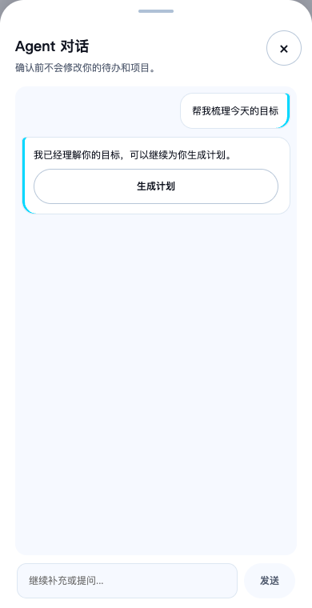

# Agent 对话细节优化验收

按用户截图修正正式对话：移除回复 Agent 标签，等待文案改为“Agent 思考中”；发送按钮去掉青色外圈与光晕，禁用时无焦点圈，启用时保留灰色键盘焦点；输入框由 52px 缩至 44px，保留多行输入及原有发送逻辑。

## 实际验证

- 先修改现有进度测试，确认因旧文案失败，再实施；客户端测试 89/89 通过。
- 隔离服务、合成账号运行 phase3-agent 与 agent-resilience：15/15 通过。覆盖多轮、发送失败、确认互斥、状态恢复、计划编辑及删除撤销。
- 320×844、390×844、480×844、390×560：输入框高度 44px、输入及发送可见，禁用发送无轮廓/阴影；已有 Phase 3 无障碍及布局断言通过。
- lint、typecheck、build 通过；构建首次受沙箱 macOS 系统配置崩溃影响，在正常本地权限下重新构建通过。格式与 diff 检查通过。
- 未进行真机软键盘专项验证；没有修改输入事件或业务接口。

T24 继续待审；未部署公网，未进入 T25–T27。
