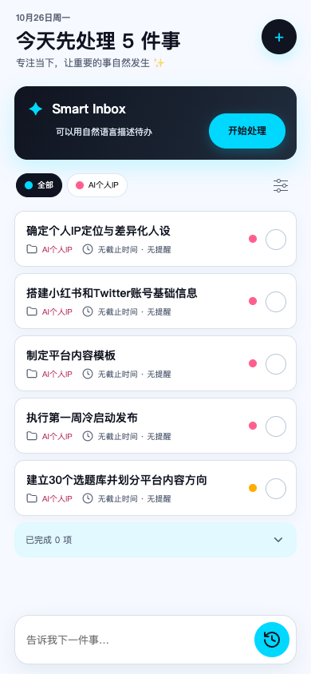
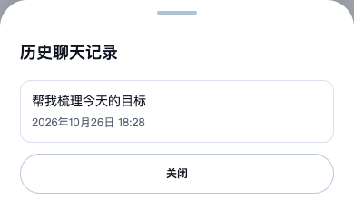

# 首页输入与历史会话入口验收

## 实现

- 输入栏显式使用 border-box、左右相同 inset 和固定内部间距；移除星星及装饰分隔线。
- 多行输入保留滚动能力，隐藏 Firefox/WebKit 滚动条。
- 空输入显示 Lucide rotate-ccw-clock（本地 history.svg）；输入后仍切换为发送。来源固定版本和 ISC 许可证记录在图标目录。
- 历史列表复用自适应 BottomSheet，提供空态、加载、重试和加载更多。记录支持 Tab、Enter/空格；标题单行省略，显示创建时间。
- 新增认证只读 GET /conversations，按创建时间及 ID 倒序分页；查询条件强制当前 userId，其他账号或不存在游标返回 404。无需数据库迁移，不触发模型和积分。
- 点击记录使用现有 OPEN_AGENT_CONVERSATION，重新读取服务器消息并用原 conversationId 续聊。沿用既有单会话最近 100 条消息窗口；本次不改变模型上下文预算和确认规则。

## 实际执行

- 先补契约失败测试（新列表 Schema 尚不存在），再实现。
- pnpm test：12/12 工作区任务成功（7 项缓存）；本次受影响客户端 89、契约 55、服务端 127 项单测通过。
- agent-runtime.integration.test.ts：21/21，通过真实隔离数据库验证分页、相同时间排序、不重复与账号隔离。
- 定向 E2E：mobile-refresh 及 phase3-agent 5/5；历史入口专项最终 1/1。首轮发现历史行缺少按钮语义，第二轮发现文字对比度受默认按钮背景及入场阶段影响；已修正按钮语义、键盘操作、白底，并在入场结束后运行 axe。
- 历史专项验证刷新后回显旧消息、原 conversationId 继续提问；320×844、390×844、480×844、390×560 下左右间隙差小于 1px、隐藏输入滚动条、发送按钮可见。axe 无违规。
- lint、typecheck、build 和 diff 检查通过。未进行真机软键盘专项测试或生产部署。

## 证据

T24 保持待审；未进入 T25–T27。用户原有 apps/miniprogram 未纳入改动。
